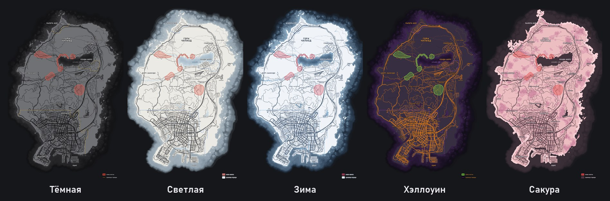
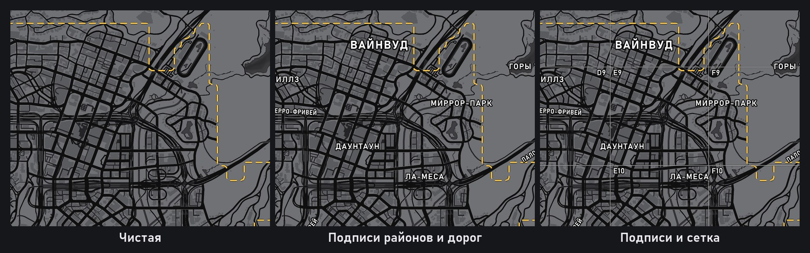
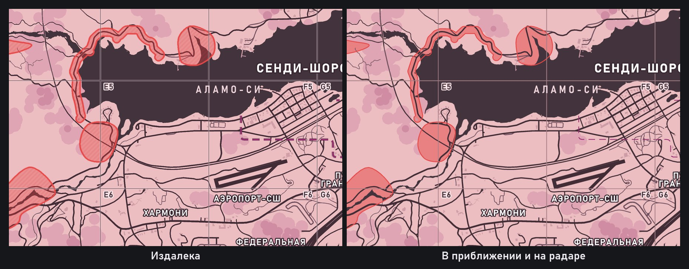
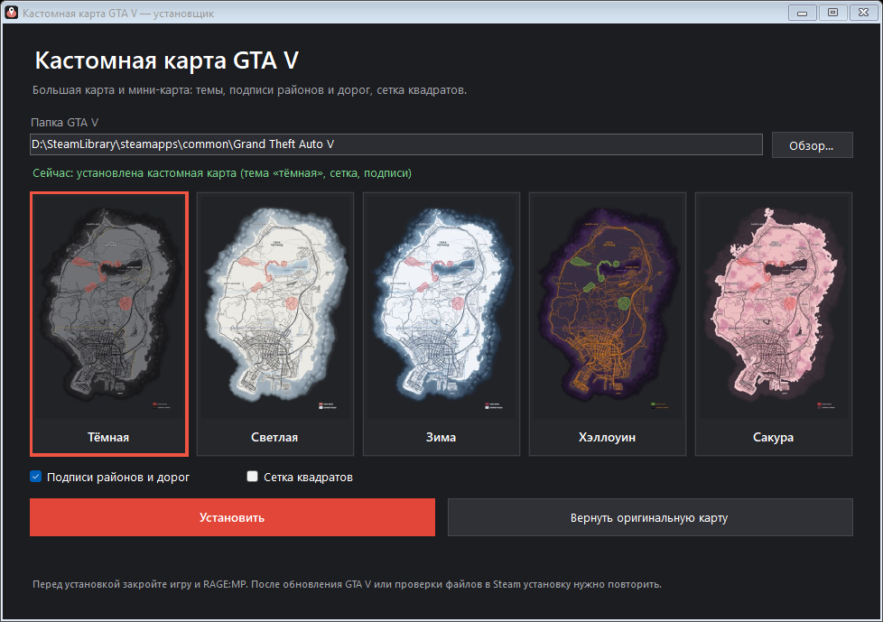

# NovaMap

**Кастомная карта GTA V для RP-сервера NOVA RP (RAGE:MP)** 
Большая карта в меню паузы и радар: пять тем, подписи на русском, сетка квадратов.

## Возможности

- **Пять тем:** тёмная, светлая, зима, хэллоуин и сакура.
- **Подписи районов и дорог** по-русски. Можно отключить и получить «чистую» карту.
- **Сетка квадратов** 1×1 км (A1…I12), удобно договариваться о месте встречи. Включается отдельно.
- **Зоны с сервера** (контур и заливка, границы примерные) и пунктирные границы Лос-Сантоса, Сэнди-Шорс и Палето-Бэй.
- **Одинаковый вид на любом зуме:** подписи, сетка и зоны есть и на дальнем виде, и в приближении, и на радаре.
- **Установка в пару кликов** и возврат оригинальной карты одной кнопкой.

Картинки на этой странице — рендеры карты, а не скриншоты из игры.

## Установка

1. Скачайте [NovaMap_Installer.exe](https://github.com/Unandoriz/novarp-map/releases/latest/download/NovaMap_Installer.exe).
2. Закройте игру, RAGE:MP и OpenIV.
3. Запустите установщик. Он попросит права администратора, чтобы записать файлы в папку игры.
4. Папка игры находится автоматически. Если нет, нажмите «Обзор…» и укажите папку с `GTA5.exe`.
5. Выберите тему и галочки, нажмите «Установить». Это занимает несколько секунд.

Чтобы сменить тему, просто установите другую: предыдущая снимется сама. Вернуть всё как было можно кнопкой «Вернуть оригинальную карту».

## Важно

- После обновления GTA V или проверки файлов в Steam карту нужно поставить заново. То же самое, если другой мод или лаунчер переписал `update.rpf`.
- Установщик меняет только `update\update.rpf` и `x64e.rpf`, а откат возвращает их к состоянию до установки.
- Поддерживается обычная GTA V (Legacy), на которой работает RAGE:MP. GTA V Enhanced не поддерживается.
- Перед заходом в официальную GTA Online лучше вернуть оригинальную карту.
- Установщик не подписан, поэтому Windows может предупредить о неизвестном издателе.
- Карта меняет только внешний вид и не показывает ничего, чего нет на обычной карте игры, кроме зон сервера. Правила меняются, так что перед установкой сверьтесь с актуальными правилами своего сервера.

## Для разработчиков

Как устроен проект и как собрать установщик из исходников: [docs/BUILD.md](docs/BUILD.md).

## Авторы и лицензии

Неофициальный проект, не связан с Rockstar Games, Take-Two Interactive и администрацией NOVA RP. Grand Theft Auto принадлежит её правообладателям. Файлов игры в репозитории нет.

Работа с архивами игры опирается на [CodeWalker](https://github.com/dexyfex/CodeWalker), подробности в [THIRD_PARTY_NOTICES.md](THIRD_PARTY_NOTICES.md).
